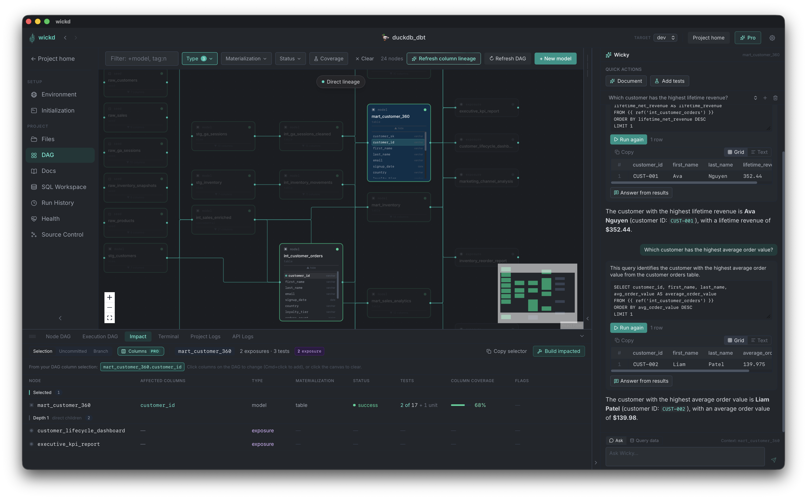

# wickd — the desktop app for dbt

[](https://github.com/EricLamphere/wickd/actions/workflows/tests.yml)
[](https://github.com/EricLamphere/wickd/releases)
[](LICENSE)
[](https://github.com/EricLamphere/wickd/releases/latest)
-lightgrey?logo=apple)

A local-first desktop app for [dbt-core](https://github.com/dbt-labs/dbt-core): an interactive dependency graph, live run/build/test with streaming logs, an in-app SQL editor, and Git, all running against your own dbt projects. No cloud account, and no data leaves your machine.



## Getting Started

**[Download wickd from lampherelabs.com](https://lampherelabs.com/tools/wickd)**

1. Download the `.dmg` for macOS (Apple Silicon).
2. Open it and drag **wickd** into **Applications**.
3. Launch wickd and point it at the folder that holds your dbt projects.

The app is signed and notarized by Apple, so it opens like any other Mac app. You'll need `git` on your `PATH`. dbt itself is installed for you: on first launch a setup wizard asks where your projects live, which Python to use and which dbt-core version you want, then installs dbt into an isolated environment.

wickd is free and open source. [wickd Pro](https://lampherelabs.com/tools/wickd#pricing) is an optional subscription that adds advanced features and supports continued development. You can upgrade from **Upgrade to Pro** in the app's header.

Don't feel like downloading the app or paying for pro? Run it for free in your browser instead:
```sh
task start
```

## Features

- **Interactive DAG** — dependency graph with live status badges, dbt selector syntax (`+model`, `tag:x`), upstream/downstream traversal, and real-time updates while models run. Multi-select nodes to run, build, or test a whole slice at once
- **Run / build / test** — trigger any dbt command from the side panel with upstream/downstream/full selectors; logs stream live
- **SQL Workspace** — a scratchpad with the Monaco editor (the engine behind VS Code), a Compiled SQL tab, and a resizable results pane. Cmd+Enter runs, Cmd+S saves
- **File explorer & editor** — browse and edit model SQL, YAML, and config with autocomplete on refs, sources, and documented columns; a VS Code-style file tree with drag and drop (including from Finder), multi-select, cut/copy/paste, duplicate, inline rename and keyboard shortcuts
- **Source control** — a VS Code-style Git panel: stage, diff, commit, push/pull, switch branches, and browse history
- **Docs browser** — native dbt docs with searchable columns, cross-linked to the DAG and editor; macros include a live "Try It" compiler
- **Health checks** — an overview of your connection (`dbt debug`), schema drift between your warehouse and `manifest.json`, and source freshness, with one-click Run all, status badges, and warnings when results are out of date. Drift separates models that aren't built yet, and lets you rebuild, re-check, open the YAML, or document new columns per model; freshness puts sources closest to their thresholds first
- **Documentation generator** — adds a model (or seed/snapshot) and its warehouse columns to the schema YAML in its folder, creating the file if needed; also from Schema Drift for warehouse-only columns. You review the change as a diff before it's written, and existing YAML is left untouched apart from the added lines
- **Impact analysis** — select a model to see everything downstream of it, grouped by depth, with test counts, column coverage, and risk flags (untested models, exposures, incremental models, failing or stale nodes); build the whole impacted slice or copy its selector in one click. Also works on your git changes: see what your uncommitted work, or your whole branch vs. `main`, affects before you commit or open a PR, including models changed indirectly through an edited macro
- **Data preview** — see any model's output (via `dbt show`) in the side panel next to its SQL, and the failing rows behind a failed test
- **Column profiling & test coverage** — row counts, null %, distinct counts, min/max, and samples per column; an optional DAG overlay shows per-column test coverage
- **Run history** — every dbt invocation with duration and per-node results, plus per-node trends across recent runs, a timeline of each run showing what every dbt thread was doing, and a DAG overlay of each node's median run time
- **Environment control** — global default env vars, named env var profiles, dbt target switching, and an init pipeline (`pip install`, `dbt deps`, your own scripts) that runs when a project opens
- **Integrated terminal & project creation** — multi-tab terminal in the bottom pane; `dbt init` runs in an in-app terminal with adapter install and `profiles.yml` setup handled for you
- **Command palette** — ⌘K to jump to any page, project, or model, or run a dbt command
- **Search across projects** — find a model, source, seed, snapshot, exposure or column in any of your projects from the home page search box or ⌘K, and jump straight to it in the DAG
- **Node DAG & Node SQL** — bottom-pane tabs showing the full upstream and downstream lineage of whatever node you have selected, on any page (filterable by type, materialization, and status), and its uncompiled SQL
- **Live sync with disk** — wickd watches your project, so a dbt run or compile from another terminal updates the DAG and run statuses, and commits or branch switches made outside the app show up in the Git panel, all without a reload
- **Light & dark themes** — the whole app, switchable from Global Settings
- **Back / forward navigation** — header arrows (or ⌘[ / ⌘] or ⌘← / ⌘→ and mouse side buttons) step through your last 25 pages, in-page tabs, opened files, and selected DAG/docs nodes
- **Arbitrary dbt commands** — type any `dbt …` command (from ⌘K or the project homepage) and it runs with your active profile and target, streams to the Run panel, and lands in run history
- **DAG exports** — export the DAG exactly as it's filtered on screen as an interactive HTML page (pan, zoom, search, the same selector and Type/Materialization/Tag/Status filters as the app, and optional model lineage tracing — plus column lineage with Pro — all offline; include the whole project so viewers can re-filter it, or only the nodes shown) or as an SVG or PNG image; the selector and filters used are printed at the top, and you choose the folder (~/Downloads by default)
- **Column-level lineage** (Pro) — click any column in the DAG to trace where its data comes from and where it goes, derived from each model's compiled SQL
- **Wicky, the local AI assistant** (Pro) — a private AI model that runs on your machine (downloaded once; or point it at your own Ollama/LM Studio server), in a panel on every project page (⌘I). Ask questions about your project or the selected model (including its latest run and test results), explain failures, query your warehouse (Wicky writes a read-only SELECT you review and run, then answers from the rows), and generate model/column descriptions and data tests (checked against your warehouse first) that you review as a diff and accept before anything is written — see [how Wicky works](docs/wicky.md)
- **Lineage propagation** (Pro) — fill empty column descriptions from the documented upstream column they pass through (unchanged, renamed or cast; doc blocks kept), and trace tagged columns like `pii` to every downstream column, model and exposure they reach (including derived columns), then write the inherited tags to YAML — all reviewed as a diff before anything is written
- **Refactors** (Pro) — rename a model or a column everywhere it's used (refs, YAML, downstream SQL, `relationships` and unit tests), or extract a CTE into its own model, from a menu or by asking Wicky; every edit is shown as one multi-file diff to review, anything wickd isn't sure about is listed for you instead of changed, and once applied it runs `dbt parse`, with one-click undo — see [Refactor models and columns](docs/how-to/refactor.md)
- **Smarter test suggestions** (Pro) — tests backed by your project's structure: `relationships` and `not_null` on the columns other models join on, `unique` on each model's grain, ranked by how much depends on each column and shown with the evidence. Health → Test Gaps lists the riskiest untested columns and proposes tests for many models at once, no AI model needed — see [Find and fill test gaps](docs/how-to/find-test-gaps.md)
- **Column-level impact** (Pro) — in the Impact tab, pick the columns you're changing to see only the downstream columns, models and tests they reach, including models that filter, join or group on them (which changes every row)
- **Run performance insights** (Pro) — find each run's critical path (the chain of models that set its wall time) and time lost waiting for threads, spot models that got meaningfully slower than their usual time, and get evidence-backed recommendations: make a model incremental, materialize a busy view, raise threads, or break up a bottleneck

## Developing wickd

You'll need Python 3.11+, Node.js 20+, and [Task](https://taskfile.dev) (`brew install go-task`).

```bash
task install    # set up the Python venv and npm packages
task start      # run the app in your browser at http://localhost:5173
```

`task start` runs the backend and frontend dev servers with hot reload, installing (or updating) Python and npm dependencies first if needed — so on a fresh clone or after a `git pull`, it works on its own. It's the fastest way to work on wickd.

To test your changes in the desktop app itself:

```bash
task package:app   # build the desktop app (free features only) and install it to /Applications
```

See [CONTRIBUTING.md](CONTRIBUTING.md) for tests, configuration, architecture, and packaging details.

Built with 

## License

[MIT](LICENSE)

dbt and dbt Core are trademarks of dbt Labs, Inc. wickd is an independent project and is not affiliated with or endorsed by dbt Labs.
